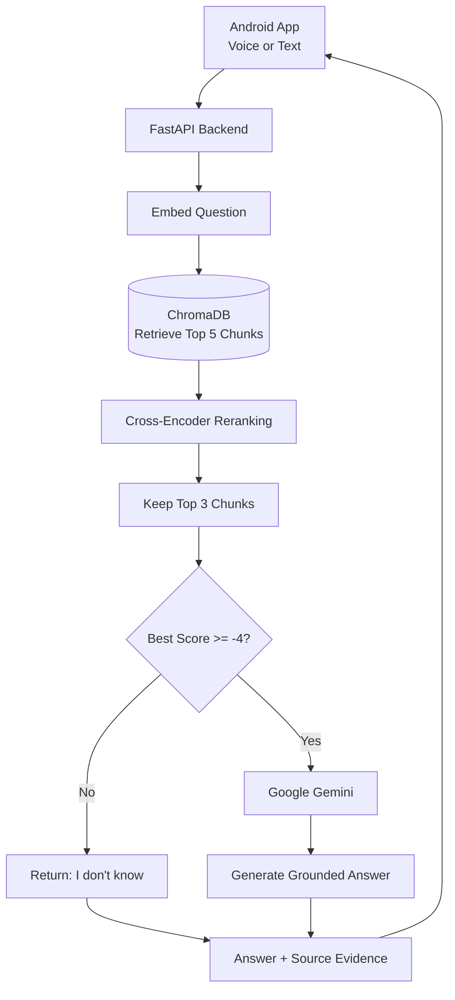

# Personal RAG Assistant

A Retrieval-Augmented Generation (RAG) application that answers questions using personal notes. It retrieves relevant information, reranks the results, generates grounded answers using Google Gemini, and provides source evidence. When the retrieved evidence is insufficient, it returns an appropriate refusal instead of guessing.

The project includes a **FastAPI backend, an Android application with voice interaction, and an evaluation pipeline** for measuring retrieval and refusal performance.

## Key Features

- **Document Ingestion:** Reads `.txt` and `.md` files from the `docs/` directory.
- **Sentence-Based Chunking:** Splits documents into sentence-based chunks while preserving context.
- **Semantic Search:** Uses `all-MiniLM-L6-v2` embeddings to retrieve relevant information.
- **Vector Database:** Stores and searches document embeddings using ChromaDB.
- **Cross-Encoder Reranking:** Uses `ms-marco-MiniLM-L-6-v2` to improve the ranking of retrieved chunks.
- **Refusal Gate:** Rejects questions when the best reranker score falls below a configurable threshold.
- **Grounded Answer Generation:** Uses Google Gemini to generate answers based on retrieved notes.
- **Source Evidence:** Returns source filenames and retrieval scores alongside answers.
- **REST API:** Exposes FastAPI endpoints for asking questions, ingesting documents, and checking service health.
- **Android Application:** Built with Kotlin and Jetpack Compose, supporting voice input and spoken responses.
- **Evaluation Pipeline:** Measures retrieval performance and refusal accuracy using tuning and held-out question sets.

## Technology Stack

| Category | Technology |
|---|---|
| Programming Language | Python |
| Backend Framework | FastAPI |
| Vector Database | ChromaDB |
| Embedding Model | `all-MiniLM-L6-v2` |
| Reranking Model | `ms-marco-MiniLM-L-6-v2` |
| Language Model | Google Gemini |
| Machine Learning Libraries | sentence-transformers |
| Android Development | Kotlin, Jetpack Compose |
| API Documentation | Swagger UI |
| Evaluation | Custom retrieval and refusal evaluation scripts |

## Architecture

The application follows a Retrieval-Augmented Generation workflow.



### How It Works

1. **Document Processing:** Reads personal notes from the `docs/` directory.
2. **Chunking:** Splits the extracted text into sentence-based chunks of approximately 200 characters.
3. **Embedding Generation:** Converts each chunk into a vector using `all-MiniLM-L6-v2`.
4. **Vector Search:** Retrieves the five most relevant chunks from ChromaDB.
5. **Reranking:** Uses the cross-encoder to rescore the retrieved chunks and selects the top three.
6. **Refusal Decision:** Compares the highest reranker score against the configured threshold of `-4`.
7. **Answer Generation:** If the evidence passes the threshold, Google Gemini generates an answer grounded in the retrieved notes. Otherwise, the system returns a refusal.
8. **Evidence Reporting:** Returns the answer, source filenames, scores, and latency.

## Evaluation and Results

The retrieval and refusal pipeline was evaluated through iterative experiments. Each version was measured, and the results were recorded in `results.txt`.

### Tuning Set Results

| Version | Experiment | Hit@1 | Hit@3 | Correct Refusals |
|---|---|---:|---:|---:|
| v1 | Baseline with 200-character chunks and embedding threshold of 0.15 | 88% | 100% | 25% |
| v2 | Per-chunk embedding threshold of 0.22 | 88% | 88% | 75% |
| v3 | Threshold applied to the top chunk only | 88% | 88% | 75% |
| v4 | Retrieve five chunks, rerank, and keep three | 88% | 100% | 75% |
| v5 | Reranker-based refusal threshold of -4 | 88% | 100% | 100% |

### Held-Out Evaluation

The final configuration was tested on six additional questions that were not used during threshold tuning.

| Metric | Result |
|---|---:|
| Hit@1 | 67% |
| Hit@3 | 100% |
| Correct Refusals | 100% |

**Important:** The held-out results are based on a small dataset and should not be interpreted as a guarantee of production performance.

### Key Findings

- Fixed-size chunking sometimes split sentences and separated related information. Sentence-based chunking was introduced to preserve context.
- Embedding similarity alone was not sufficiently reliable for distinguishing answerable from unanswerable questions.
- The cross-encoder provided better separation between relevant and irrelevant evidence in the tested examples.
- Retrieving five chunks and reranking them improved Hit@3 from 88% to 100% in the reported experiments.
- The reranker-based refusal gate achieved 100% correct refusals on the reported tuning and held-out sets.
- Hit@1 remains an area for improvement, particularly for broad or ambiguous questions.

## Project Structure

```text
personal-rag-assistant/
├── api.py
├── rag.py
├── ask.py
├── eval.py
├── eval2.py
├── results.txt
├── requirements.txt
├── docs/
│   ├── about_me.txt
│   └── projects.txt
├── README.md
└── .gitignore
```

## Prerequisites

- Python
- Git
- A Google Gemini API key
- Internet access to download the embedding and reranking models on first use

The Android application additionally requires Android Studio and a compatible Android device or emulator.

## Installation and Setup

### 1. Clone the Repository

```bash
git clone https://github.com/Gajjala-Hemanthi/personal-rag-assistant.git
cd personal-rag-assistant
```

### 2. Create a Virtual Environment

**Windows — PowerShell**

```powershell
python -m venv .venv
.\.venv\Scripts\Activate.ps1
```

**macOS/Linux**

```bash
python -m venv .venv
source .venv/bin/activate
```

### 3. Install Dependencies

```bash
python -m pip install --upgrade pip
pip install -r requirements.txt
```

### 4. Configure the Gemini API Key

Obtain an API key from [Google AI Studio](https://aistudio.google.com/).

**Windows — PowerShell**

```powershell
$env:GEMINI_API_KEY = "your_key_here"
```

**macOS/Linux**

```bash
export GEMINI_API_KEY="your_key_here"
```

Replace `your_key_here` with your actual API key.

Keep the key private and never commit it to Git.

### 5. Add Your Notes

Place your `.txt` and `.md` files in the `docs/` directory.

Example:

```text
docs/
├── about_me.txt
└── projects.txt
```

### 6. Build the Vector Index

```bash
python rag.py ingest
```

Run this command whenever you want to rebuild the index after changing your notes.

### 7. Start the FastAPI Server

```bash
python -m uvicorn api:app --host 127.0.0.1 --port 8000
```

### 8. Open the API Documentation

Visit:

`http://127.0.0.1:8000/docs`

Swagger UI lets you inspect the available endpoints and test API requests interactively.

## Usage

### Ask a Question from the Command Line

```bash
python ask.py "what phone did I test on?"
```

The application retrieves relevant notes and returns an answer with supporting source information.

### Ask a Question Through the REST API

**Endpoint:** `POST /ask`

Example request:

```json
{
  "question": "What phone did I test on?"
}
```

The API returns the generated answer and its associated evidence, according to the response schema implemented in the backend.

### Ingest Documents Through the API

Use the `POST /ingest` endpoint to trigger document ingestion through the API.

### Check API Health

Use `GET /health` to check the service's health status.

For the exact request and response formats, refer to the Swagger documentation at `/docs`.

## Running the Evaluation

Ensure the vector index has been built before running the evaluation.

```bash
python eval2.py
```

The evaluation script reports retrieval hit rates and refusal performance for the tuning and held-out question sets.

The results are used to compare retrieval configurations and assess whether changes improve performance.

## Security Considerations

- Store API keys in environment variables rather than hardcoding them.
- Never commit API keys, passwords, or other secrets to GitHub.
- Review `.gitignore` before pushing changes.
- Avoid indexing personal information that you do not want processed by the application or its external services.
- Retrieved notes are sent to Google Gemini when generating answers. Do not send sensitive information unless you understand and accept the associated data-handling implications.
- Keep the Gemini API key on the backend; never embed it in the Android application.

## Limitations

- The evaluation datasets are small, containing 12 tuning questions and six held-out questions.
- Hit@1 is weaker than Hit@3, indicating that the most relevant chunk is not always ranked first.
- The refusal threshold was tuned using a limited dataset and may not generalize to other notes or question types.
- Cross-encoder scores are model-dependent; the threshold of `-4` should not be assumed to work for every dataset.
- A high retrieval hit rate does not guarantee that generated answers are factually correct.
- The application depends on network access and Gemini API availability for answer generation.
- The Android application requires a reachable backend. A server bound to `127.0.0.1` is accessible only from the same host, so a physical Android device needs an appropriate network-accessible backend configuration.

## Future Improvements

- **Hybrid Search:** Combine keyword-based retrieval with vector search to improve Hit@1.
- **Advanced Retrieval:** Explore query expansion, metadata filtering, and alternative reranking strategies.
- **Automated Answer Evaluation:** Add answer correctness and faithfulness metrics alongside retrieval metrics.
- **Larger Evaluation Dataset:** Expand the tuning and held-out sets to improve confidence in the results.
- **Production Deployment:** Deploy the FastAPI backend so the Android application can access it without a USB connection.
- **Tool Calling:** Explore controlled integration with external tools for tasks that require current information.
- **Observability:** Add structured logging, latency tracking, and error monitoring.

## Acknowledgments

This project uses open-source technologies including FastAPI, ChromaDB, sentence-transformers, and the associated embedding and reranking models. Google Gemini is used for grounded answer generation.
